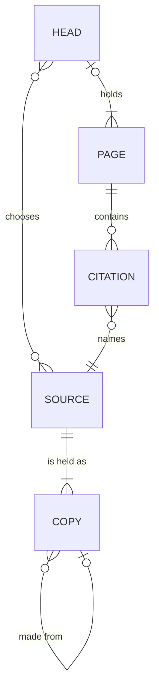

## The library

**Source**:
One fixed text the `owner` would cite, such as a book, a paper or an essay, in one edition and one language. A revised edition, a translation or a free retelling is another `source`; a reprint, a new format or a new publisher of the same words is the same one.
_Avoid_: version, edition, work; "source" for where a file came from

**Slug**:
The one name a `source` goes by, such as `blair-too-much-to-know`. It never changes.
_Avoid_: id, key, filename

**Public**:
A `source` the `owner` is content to have named in public. Every `source` is private until the `owner` marks it `public`, one by one, and marking one never publishes anything.
_Avoid_: shared, published

**Copy**:
One file the library holds of a `source`, such as an EPUB, a PDF or a scan. A `copy` is either downloaded, or made from another `copy`, like the markdown text made from an EPUB.
_Avoid_: edition, format

**Origin**:
Where a `copy` came from: the site it was downloaded from, or the `copy` it was made from.
_Avoid_: provenance, source

## Judging a copy

**Lossy**:
How much a `copy` is missing of what its `source` has, such as cut-off pages, dropped equations or stripped figures. It is a matter of degree, and the opposite end is `lossless`.
_Avoid_: corrupt, bad scan

**Structured**:
How much of a copy's content is real text and real structure, so a program can pick out each heading, table and equation. It is a matter of degree: an EPUB, an SVG or arXiv's HTML is highly `structured`.
_Avoid_: machine-readable, native

**Flat**:
The opposite end from `structured`: a `copy` that is a picture of its content, so every word is visible but a program must read the picture to get them back. A scan or a PNG is `flat`, a PDF of printed pages nearly so, and a perfect scan is `lossless` and `flat` at once.
_Avoid_: image-only, unstructured

**Dirty**:
A `copy` whose title, authors, date, publisher, language, identifiers or cover are wrong or missing. Cleaning it fixes the description and never touches the content. The opposite is `clean`.
_Avoid_: messy, misdescribed

## Knowledge

**Owner**:
The one person whose library this is, who decides what it holds and what goes public.
_Avoid_: user

**Librarian**:
The AI that keeps the library for the `owner`. It shelves, proofreads and withdraws, reads `text`s, and writes `page`s when asked.
_Avoid_: agent, assistant, AI

**Text**:
The markdown `copy` made of each `source`, so the `librarian` can read and search it. A program reads it off the best `copy`; where that reading falls short, as on a `flat` page or a broken symbol font, the `librarian` `proofread`s it. Every word traces to the `copy`, and the text is remade whenever that `copy` changes. It holds the words and their structure, equations and tables; figures stay in the `copy`, where later work goes to see them.
_Avoid_: transcript, extract

**Head**:
A question the `owner` reads toward, the `source`s chosen to answer it, the ones still wanted, described in free text until shelving gives them a slug, and the `page`s written toward it. A `source` can sit under many `head`s. A `head` is private until the `owner` publishes it.
_Avoid_: tag, topic, collection, shelf

**Page**:
A markdown file written for the library. It belongs to at most one `head`; a page that belongs to none is loose, and a loose page is always private.
_Avoid_: note, annotation

**Map**:
The `page` that digests a `head`: its question sharpened, the distinctions its `source`s take sides on, verdicts on its hard questions, and when to open each `source`. It comes out critiqued, so other pages may build on it.
_Avoid_: summary, brief, ontology, overview

**Citation**:
The mention of a `source` on a `page`, by its slug and, optionally, a place in it in the writer's own words, such as `[@blair-too-much-to-know, ch. 2]`. When the place covers more than is meant, quote the words beside it.
_Avoid_: passage, reference, excerpt, link

## Verbs

**Shelve**:
Put a checked `copy` into the library, creating its `source` if it is new. Shelving a better `copy` of the same `source` replaces the worse one.
_Avoid_: onboard, import, ingest

**Proofread**:
Correct a program's reading of a `copy` against its page images, in a subagent, as edits that a program applies and checks against every machine reading of the page. The `text` that results keeps every word traceable to the `copy`.
_Avoid_: transcribe, retype, OCR

**Withdraw**:
Take a `source` out of the library, with every `copy` of it and its `text`. The `page`s that cite it stay.
_Avoid_: delete, remove, unshelve

**Digest**:
Read a `head`'s `source`s until they are the `librarian`'s own, and write the `head`'s `map` from them, then have it critiqued by a reader who did not write it.
_Avoid_: summarise, synthesise, build

**Publish**:
Make a `head` public, with all its `page`s. It cannot happen while the `head` names a `source` that is not `public`.
_Avoid_: share, release

## Relationships

